# Ovation Logic Lab 使用说明

产品2.2.0，内核0.38.0。更新于2026-11-23。软件顶部“使用说明”会在独立标签打开，可按专题页签查看步骤和配图，也可从解压目录直接打开 [网页版使用说明](../guide.html)。

## 1. 解压后，先完成一次运行

完整解压ZIP，保留 `index.html` 与 `src`、`examples`、`docs` 的相对位置，用Chrome或Edge打开入口。断网可用，无需安装运行环境。

1. 点击顶部“示例”，载入“置位保持与复位”，扫描周期为100ms。
2. 点击“单步”5次，到0.5秒：置位输入和记忆输出均为TRUE。
3. 继续到0.8秒，输入脉冲结束，输出仍保持；到2.5秒，复位后输出为FALSE。
4. 用“运行 / 暂停”连续观察，“复位”回到本轮起点。保存自己的工程后再切换示例。

> 波形时间用秒，扫描周期用毫秒。t=0是初始快照；失败扫描保留上一完整结果，原因见状态栏和报错清单。

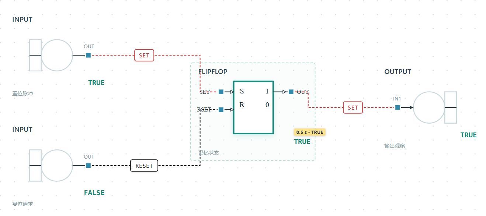

0.5秒：记忆块和OUTPUT显示TRUE，输入输出图形与本版界面一致。

新增基础块STEAMFLOW、SPTOSA、SATOSP、ANTILOG可在左侧搜索。转换与补偿示例为`examples/simple-conversions.json`，支持范围见[基础转换说明](reference/simple-conversions.md)。

## 2. 放置模块、参数与连线

1. 点击或拖动左侧模块到画布。选中模块，在右侧设置参数、初态后点“应用参数”。AND / OR可勾选所需输入引脚，图例同步变化。
2. 从输出端拖到输入端，或依次点击输出和输入。端子类型须匹配：数字量为方形，模拟量为圆形；LP整字使用独立多边形，待定类型为菱形。
3. 顶部“连线”工具可逐次点击空白放置折点，再接到端口；也可从主线引出分支，或从输入反向接到主线。分支连接处显示实心圆点。Backspace撤回折点，Esc取消草稿。

INPUT / OUTPUT可在右侧“保存名称”；列表按名称选择，同名时附内部标识。INPUT可选左侧或上部图形，OUTPUT可选右侧或底部图形；方向由用户选择，OUTPUT只有一个IN1输入脚。

空白处按住左键拖框多选，Shift追加或增减，拖动所选块可成组移动。“删除工具”可点删或框删模块、连线、示波器、探针及未解析导入线；撤销可恢复整批操作。按Esc或“选择”退出工具。

数字线为虚线，SET为红色，RESET为黑色（深色模式用浅色）；模拟线为实线，读数框显示当前值。悬停看完整值，顶部“连线数值”可开关读数框。[连线](reference/manual-wire-tool.md) · [画布工具](reference/canvas-tools.md) · [输入输出方向](reference/io-orientation.md)

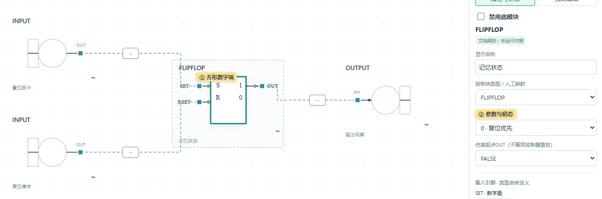

① 方形数字端。② 参数与初态在右侧配置；手册允许的端子随模块配置显示。

## 3. 设置INPUT波形与Excel导入

选中INPUT，在右侧设置名称和信号类型；下方切到“输入设置”，按模块名称选择输入源。类型受已连接端子约束，数字量只提供TRUE / FALSE操作。

1. 选择常量、阶跃或分段保持；模拟量另支持斜坡、分段线性。可先点模式或“填入示例”生成草稿。
2. 修改时刻和值。分段节点从左向右排列，满行后换行；右侧预览输入波形，圆点表示当前扫描周期的采样。
3. 检查“预览至”时间和波形，点“应用参数”后才参与仿真。切换输入源保留草稿；“恢复已应用设置”可取消草稿。

**Excel：**相邻的“导入 Excel / 下载模板”支持两列.xlsx，第一列时间（秒），第二列值。导入后先成为草稿，多工作表需选择；先看预览，再应用。公式、缺值、重复时刻等会提示错误并保留原设置。

> 例如0.35秒阶跃、100ms扫描：预览在0.35秒变化，扫描到0.4秒才采到新值。未应用草稿不写入工程，运行前会提示先应用或恢复。

[输入编辑](reference/input-wave-editor.md) · [Excel格式](reference/excel-input-waveforms.md) · 包内示例 `examples/input-waveform-trial.json`

① Excel与模板。② 修改变化时刻。③ 预览规律与实际扫描点。

### 信号质量

独立模拟量或数字量 INPUT 可在「输入设置」的信号值下方展开「信号质量」，选择常量、阶跃或分段保持。时间单位为秒。设置后点击「应用参数」，与数值波形一起保存。跨画布来源提供接收 INPUT 的质量。运行时可在块值和右侧属性查看质量，使用回看滑块检查历史。见[质量规则](reference/signal-quality.md)。

### 录波回放

1. 从左侧“信号”组添加 **WAVE_RECORDER（录波回放）**，把要采集的信号接到 IN1。类型由连线自动确定，OUT 在每个完成的扫描中输出本模块实际读到的值。也可从已有输出另拉一条支线采集。
2. 运行或单步后，点模块，在右侧属性中点“保存为新预设”。回看时只保存到所选扫描。每份预设记录数字量、模拟量或 16 位打包字的数据与原采样周期，随工程保存。
3. 暂停后选择预设，点“断开输入并回放”（已断线时为“回放所选预设”）。只断开该模块的输入线。输出类型跟随预设，若有不兼容的输出连线，请先调整。重新运行时从仿真零点回放，首个采样时刻前使用首值，末拍后保持末值。

需要重新采集时点“切回采集”，再接入信号。保存预设可撤销，复位会清除尚未保存的采集记录。

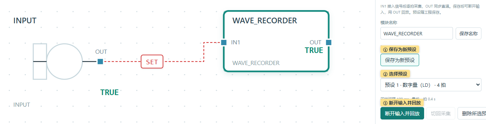

## 4. 工作区收放、画纸与主题

左右侧栏标题旁的箭头可收起为窄栏，保留名称和恢复按钮。按住画布底部操作提示条的**上边沿**上下拖动，可部分隐藏底部区域；双击恢复默认高度。

滚轮缩放，按住滚轮拖动平移；“适应画布”显示整图。顶部可切换明暗主题。布局、选择、移动、图形方向、名称和示波器显示调整保留当前运行及输入草稿。

默认画纸为**3600×2400**画布单位。下方“画纸设置”可调位置、宽高、边界线型及显隐；“包围全部内容”按对象确定边界，“查看整张画纸”查看四边。越界对象会提示，仍可编辑。画纸设置随工程保存并可撤销。

参数、已应用波形、逻辑连线或周期改变后，旧运行会清除并从配置初态重跑。[工作区操作](reference/workspace-panels.md) · [画纸设置](reference/paper-and-wave-grid.md)

①② 侧栏恢复。③ 按住此上沿拖动调整底部高度。

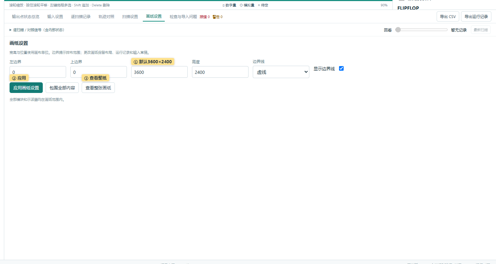

画纸位置、尺寸和显示设置集中在独立页签。

## 5. 四路示波器、历史游标与底部总览

1. 添加一个或多个示波器，拖标题移动、拖右下角改大小。左侧CH1～CH4分别对应四路输入，拖线或点选端口可直接接入；“接入探针”使用第一个空闲端口。接到已有信号的端口可替换该路。内部状态在右侧属性中选探针后接入。标题右侧“−”收起为小示波器图标，点击图标展开；收起后仍保留四个端口和全部采样，拖图标可以移动。
2. 四色卡片分别显示信号名和值。自动模拟量共用范围，便于比较幅值；“量程”可逐路设固定上下限。点击信号卡片，切换左侧纵轴。
3. 先运行或单步，再点“游标”。点击或拖动图中虚线，四路读数同步到最近的真实扫描；时间栏显示实际秒数和扫描号。左右键逐拍，Home / End到窗口首尾，再点按钮或Esc关闭。

**FIFO时间窗：**横轴固定为0～窗口长度，先从左向右填充，满窗后整体左移并加入新数据。时间栏另列实际时间范围；选择信号不改变横轴刻度，滚出窗口的数据仍保留在完整记录里。

**底部“输出点状态总览”：**点击“输出点”展开按名称勾选OUTPUT，可选一个或多个；其时间窗、彩色读数方式和游标操作与示波器一致，选择数量不限4路。“逐扫描 / 对照信号”独立选择记录表及参考对照通道。

局部游标不改变仿真或全局历史位置；全局“回看”滑块则让画布和图表一起回看。模拟读数显示6位有效数字，悬停看完整值。旧示波器配置超过4路时保留引用、明确只显示前4路，可在信号列表取消旧路后切换。[详细规则](reference/oscilloscope-charts.md) · 示例 `examples/oscilloscope-four-channels.json`

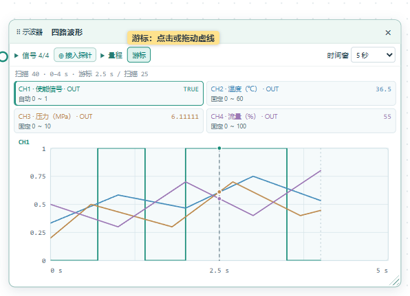

点“游标”后拖动虚线，所有卡片读取同一拍；各路固定量程可分别设置。

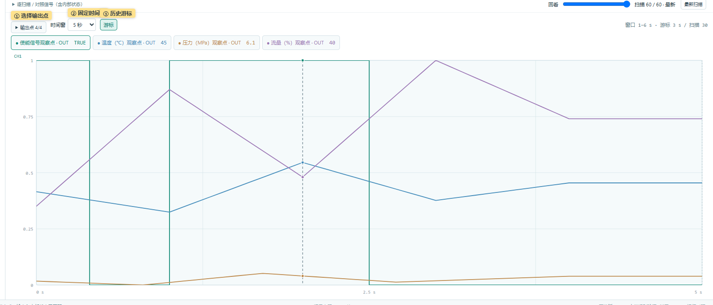

① 选择OUTPUT。② 固定时间窗。③ 历史游标；FIFO只滚动显示，不删除记录。

## 6. 禁用、溯源恢复与临时强制

### 只运行相关逻辑

右侧“禁用此模块”或画布“禁用 / 恢复”工具可点选屏蔽或恢复模块。禁用块变灰、连线保留；依赖它的下游自动“依赖暂停”，独立支路继续运行，不会用0 / FALSE替代缺失信号。

1. 在“溯源恢复”旁选范围，再点击工具：默认“单页溯源”只禁用当前页；“跨页溯源”禁用全部画布，只有一张画布时灰色不可用。
2. 逐个点击需要的OUTPUT观察点或其IN1端子，累加恢复全部上游及相关依赖；普通算法的OUT脚不是选择对象。
3. 单页只恢复本页上游；跨页沿同名共享信号恢复其他页依赖。Esc退出保留范围，重新进入重新禁用所选范围；切换范围先退出工具，再点击开始。禁用范围可撤销并随工程保存，改变范围会清除旧运行。

### 固定某个算法的输出

暂停后选中非INPUT / OUTPUT模块，切到右侧“强制输出”。逐引脚勾选：数字量选0 / 1，模拟量填数值，再“应用强制”；可“取消本模块强制”。LP整字不提供强制。

模块内部仍正常计算，下游接收强制值；右侧分别显示“计算”和“输出”。被强制信号的整条主线、分支和连接圆点为橙色，取消后恢复。

> 强制仅当前页有效，刷新或关闭后丢弃，普通工程不保存。应用 / 取消会清除旧运行，从初态重跑；完整运行记录仍保留当次强制证据以供复算。

[禁用规则](reference/disabled-blocks.md) · [溯源恢复](reference/output-recovery.md) · [强制输出](reference/output-forces.md)

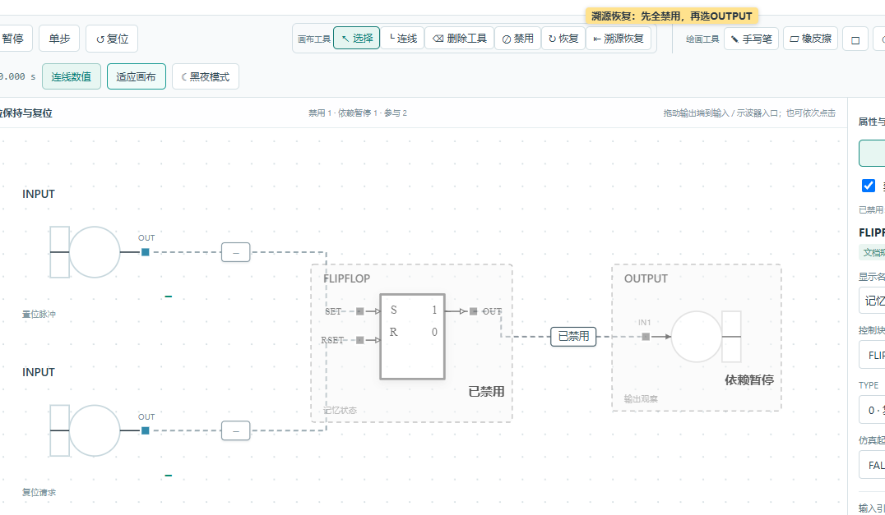

禁用和依赖暂停都有状态标记，连线仍保留。溯源恢复只从OUTPUT终端选择目标。

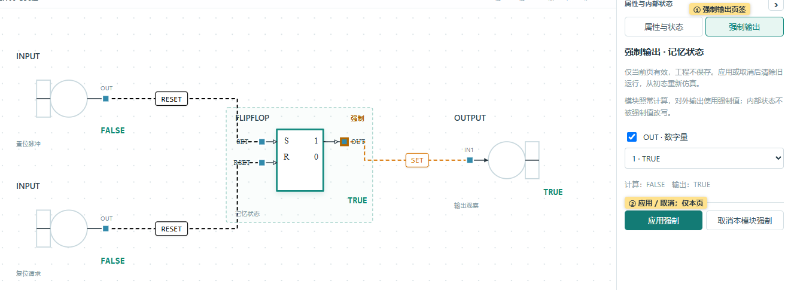

① 强制页签。② 应用或取消；原计算值与实际发布值分开显示。

## 7. 临时手写、形状、文字与擦除

“绘画工具”与画布工具分开排列。点击相应工具打开设置，颜色及粗细 / 字号在各自面板内调整：

- **手写笔：**设置颜色和粗细，按住左键标注。
- **□方框 / ○圆形：**拖动绘制矩形或椭圆，Shift约束为正方形或正圆。
- **T文本：**设置颜色和字号，点击位置后输入；Enter换行，Ctrl+Enter或点别处完成，Esc取消当前输入。使用系统字体。
- **橡皮擦：**整笔擦除移除碰到的整个笔画、形状或文本；局部擦除只擦接触部分，大小可调。

先用Esc或关闭按钮收起设置，再按Esc或点“选择”退出绘画。标注覆盖在功能块与示波器上方，退出后可正常操作页面；标注按屏幕坐标绘制，不随画纸平移和缩放。

> 笔迹、形状、文字和擦除都只保留本页，刷新或关闭后丢弃；工程与运行记录不保存标注。需要留存时可通过“错误反馈”截图。

[绘画与擦除说明](reference/temporary-drawing-tools.md)

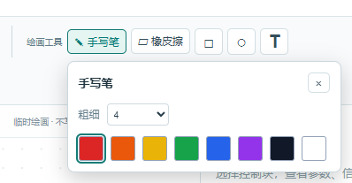

点击工具打开颜色、粗细或字号设置，设置只影响后续标注。

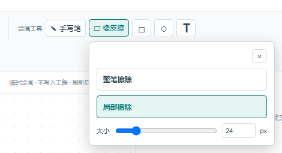

局部擦除可调大小；整笔擦除按一个完整对象处理。

## 8. 导入Control Sheet、检查与修复

1. 在画布文件区选择“导入当前画布”或“导入新画布”，再点“导入 Control Sheet”。可同时选择 SVG 及配套的 MCR、TFT、XML。若有多个主图，选定一张。当前画布模式替换选中页，新画布模式保留原页并新增一页。
2. 程序恢复已识别模块、端子和连线，端口自动映射；同源连接共用主线并显示分叉圆点，连线用横竖折线。图纸属性显示在画纸右下角。
3. 进入“检查与导入问题”，点击定位或“查看原SVG”对照。报错会阻止执行，警告只提醒；导入资料与历史快照默认折叠，保留原始来源和人工决定。
4. 按报错补足信号类型、输入波形、参数和初态。新导入可采用已核实的手册默认参数，右侧可查看依据；明确给出的无效值、未知字段和缺失工况仍需处理。
5. 在“扫描设置”明确周期、执行顺序和核对依据，再单步检查。画布位置不代表扫描顺序，反馈读回需要明确初值。

从主图导入的旧宏引用会保留外框与引脚。如需导入宏的内部逻辑并运行，可使用自定义宏的专用入口。见[自定义宏](#13-自定义宏)。

未解析导入线可选中后在右侧删除，或按Delete；原SVG和处理记录保留。

[自动连线](reference/automatic-port-mapping-and-routing.md) · [共享主线和图框](reference/shared-signal-trunks-and-title-block.md) · [默认参数](reference/manual-parameter-defaults.md) · [扫描设置](reference/scan-execution-model.md)

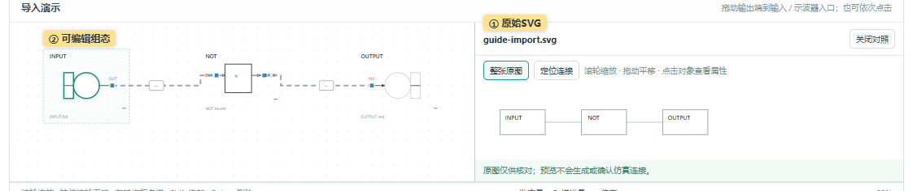

① 原始SVG。② 可编辑组态；对照原图后，按当前报错补足工况与执行前提。

## 9. 保存、完整复算与参考对照

顶部左侧集中放置新建、打开和保存工程。点击“保存工程”或Ctrl+S后，在系统窗口选择目录和文件名；取消不保存。浏览器不支持时使用下载，可在浏览器下载设置中开启“每次询问保存位置”。

| 文件 / 操作 | 保存内容与用途 |
| --- | --- |
| 保存 / 打开项目 | 已应用的组态、参数、波形、来源、示波器、画纸和禁用状态；打开后可重新运行。 |
| 导出运行记录 / 复算记录 | 当次运行的起始工程快照、完整扫描数据、模型、诊断及强制证据；完整核对一致后，点“载入”才替换当前工程和轨迹。 |
| 导出CSV | 当前运行范围的输出与已支持内部状态，供表格查看和数值对照；不替代完整运行记录。 |

记录达到页脚上限后仍可回看、导出或复算；“复位”开始新一轮。保存工程只含已应用输入，不包含临时绘画、局部游标和普通强制配置。载入含强制的复算结果，会在本页恢复当次强制并显示标记。

### 参考对照：15样本练习

1. 打开 `examples/csv-comparison.json`，单步2次。
2. 在“逐扫描 / 对照信号”选择四路输出值及ff的memory，共5路；底部OUTPUT勾选不代替这组选项。
3. 在“轨迹对照”加载 `examples/csv-comparison-reference.csv`，来源选“人工整理”，依据填“手工真值表”，三个容差均为0。
4. 点击“对照所选信号”，应得到15 / 15匹配，可导出报告。

按tick对齐，不插值或补零；数字量 / LP精确比较，模拟量按所填容差比较。CSV 对照涵盖所选信号值。[完整复算](reference/record-recompute.md) · [参考格式](reference/reference-csv.md)

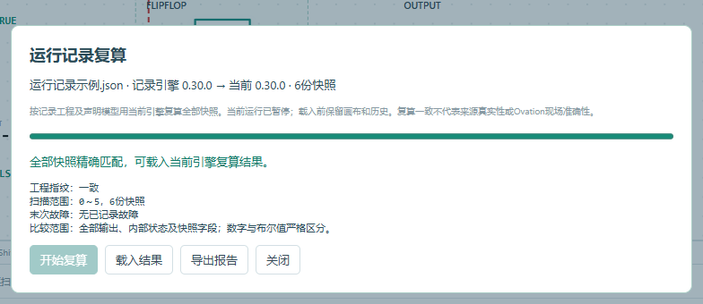

① 查看复算结果。② 一致后点击“载入结果”。

填写参考来源、工况依据和容差后，点击“对照所选信号”。

## 10. 错误反馈：图文记录并导出

1. 点击顶部“错误反馈”。可描述发生区域、涉及模块、操作步骤、预期与实际现象；**全部内容均非必填**，也可只附图片。
2. 点击“截图”并在浏览器里选择窗口；或用Win+Shift+S截图后回到反馈框Ctrl+V粘贴，也可选择现有图片，最多6张、每张10MB；可附图片说明或删除图片。
3. 选择是否附工程和完整运行记录，点击“导出反馈ZIP”；把文件作为邮件附件自行发送给开发者。

打开反馈会暂停仿真并记录当时现场，关闭后保留本页草稿，可继续编辑；“更新现场记录”替换现场信息，“清空重填”开始新反馈。刷新或关闭页面后草稿清除。

导出包包含可直接阅读的说明、结构化记录、图片及所选附件。截图选择器由浏览器控制，取消或不支持时可改用截图粘贴。

[反馈内容与文件说明](reference/error-feedback.md)

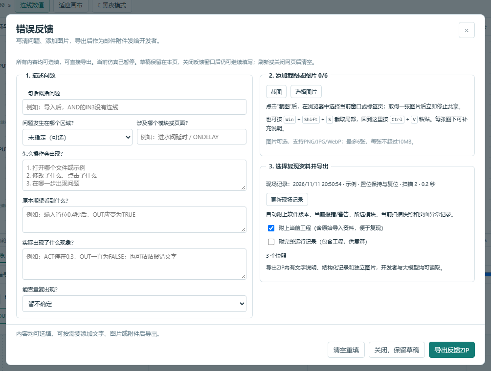

① 描述现象。② 截图、粘贴或选图。③ 导出后作为邮件附件发送。

## 11. 支持范围与常见问题

当前62种手册算法、351个最大配置手册引脚，基础点类型为LA、LD、LP。支持范围见[算法支持矩阵](algorithm-support-matrix.md)，误差与数值规则见[数值说明](validation/numeric-contract.md)。

| 现象 | 先检查 |
| --- | --- |
| 运行 / 单步被阻止 | 状态栏与“报错”组：输入、参数、初态、类型或扫描确认；“警告”不阻止执行。 |
| 模块灰色或无输出 | 是否被禁用或依赖暂停；恢复所需上游，或重新选择溯源目标。 |
| 结果被固定、连线橙色 | 右侧“强制输出”，检查原计算值；暂停后可取消强制。 |
| 第5路不能接入 | 每台示波器最多4路；先移除一路，或新增另一台。 |
| 读数停在历史时刻 | 关闭局部游标，或在全局“回看”点击“最新扫描”。 |
| 对照缺值 / 精度分歧 | 核对节点、字段、tick和t=0；保留诊断，不补零，参考容差不会改变执行规则。 |

需要协助时，可保存工程并导出完整运行记录，或直接使用“错误反馈”附图说明。

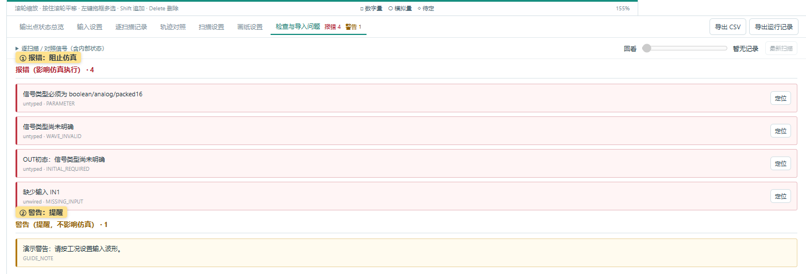

① 报错影响仿真执行。② 警告保留提醒，按具体内容处理。

变化率模块：RATEMON严格越限/回差保持；RATECHANGE仅支持SMTH=0。两块都在属性栏配置上一拍IN1软件起点，详见[模型说明](reference/rate-algorithms.md)及examples/rate-algorithms.json。

FIFO 将数字输入上升沿按顺序排队，RTAT 逐项取出，CLR 清空。属性栏显示队列与深度。参见 [FIFO 规则与示例](reference/fifo.md)。

TIMECHANGE 和 TIMEDETECT 共用“扫描设置”中的 UTC 起点。RATELIMIT 支持无跟踪限速。参见[限速与 UTC 时钟说明](reference/ratelimit-and-utc-clock.md)。

## 12. 多画布工程与信号匹配

多画布时可用“并列显示”同时观察所有页，每个面板显示名称。点击面板激活编辑，属性和底部波形随之切换。拖右下角或聚焦角标后用方向键调整宽高；Esc取消拖动，“均分尺寸”重置大小。顶部工程名称、原页签及优先级位置保持不变；所有面板共用一个工程扫描和回看帧。尺寸为会话布局，不写入工程文件。

1. 在画布上方编辑工程名称，点击“＋画布”创建另一张画布，或在旁边选择导入目标后点击“导入 Control Sheet”。各画布独立保留组态、来源与观察设置。
2. 点击页签切换，双击页签重命名：Enter或失焦保存，Esc取消。用“优先级＋”提前执行、“优先级－”延后执行；页签从左到右在同一拍依次执行。统一周期/UTC在原扫描设置中采用。
3. 不同画布唯一同名的 OUTPUT → INPUT 自动互通，去首尾空白、区分大小写、类型须相同。无来源 INPUT 继续使用自身波形，多来源或类型冲突会报错。
4. 前序画布发布本拍结果供后序读取；前序读取后序来源时取上一拍值。共享来源 OUTPUT 要填写合法 OUT 初态。任一画布运算失败，本拍全工程不提交。
5. 打开“信号匹配”后模拟暂停。左边点 OUTPUT 输出，右边点一个或多个 INPUT 输入；也可从输出圆点拖线到输入。虚线只是预览，核对下方名称修改后点“应用这条连接”。实线表示已连接，点线看两端，点卡片“定位”跨图跳转；支持撤销。两栏可独立搜索，不能连接的原因就在卡片上。
6. 顶部保存按钮保存整工程的所有画布与顺序；打开可恢复关联。导入前选择当前画布或新画布，取消/失败保留工程。
7. 切换保留各图的输入草稿、临时强制、临时标注和统一历史。普通保存不包含这些会话临时内容；完整运行记录包含所有画布的快照和当次强制，并可完整复算。

打开 `examples/multi-canvas.json`，逐拍对照同目录参考即可观察本拍传递和上一拍反馈。扫描规则见[多画布工程说明](reference/multi-canvas-projects.md)。

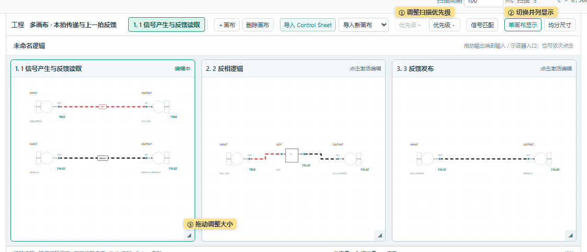

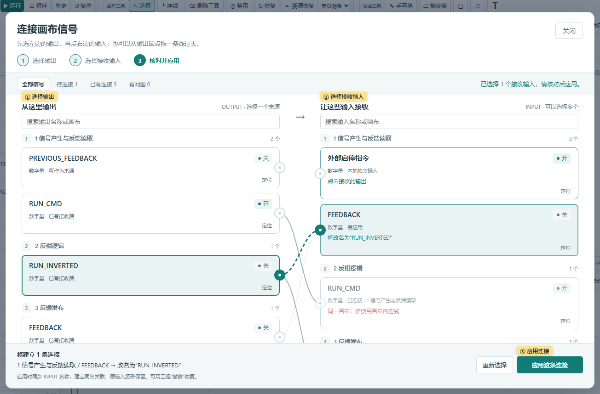

## 13. 自定义宏

1. 在左侧控制块库添加“自定义宏”，选中后点击右侧“导入宏 SVG”。可随一份 SVG 一起选择同名 MCR、TFT 配套文件。
2. 导入后，内部 INPUT、OUTPUT 的名称和已识别类型会成为外部引脚。按类型接到父画布。若某个端口类型待明确，打开宏画布，在对应 INPUT 或 OUTPUT 的属性中核对类型。
3. 双击宏块或点击“打开宏画布”，可编辑连线、参数和初态，添加示波器。点击“返回父画布”返回调用处。顶部运行、单步和回看都使用整工程的扫描记录。
4. 宏执行时从父画布引脚读取信号，本拍计算并发布外部输出。每个宏实例拥有自己的内部状态，工程保存时连同所有内部画布一起保存。

宏内的待确认连线、未知类型、缺参或未支持逻辑会在“检查与导入问题”中列出。可在宏画布内处理。若替换 SVG 会改变已接线端口，先断开受影响的连线。

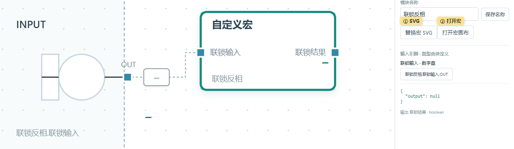

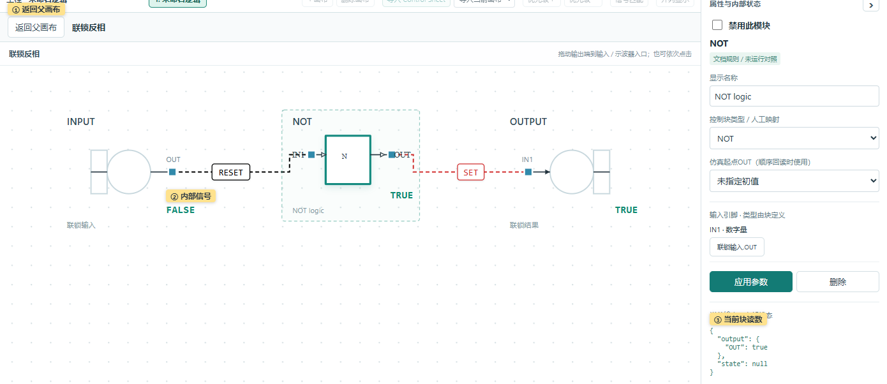
